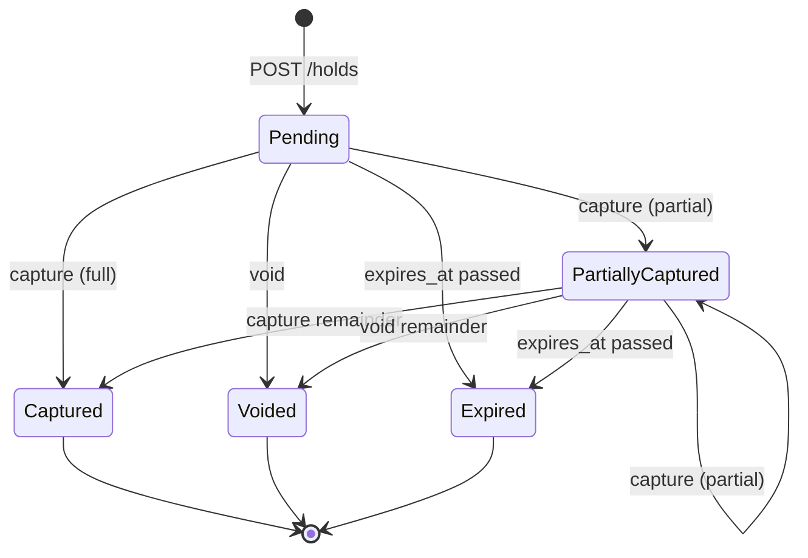
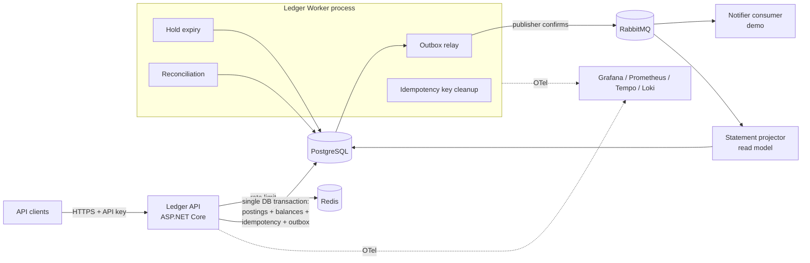

# Contrapost — Double-Entry Payments Ledger

> **Status:** Design draft, revision 2 · Oct 2026 · Personal project
> **Author:** Pratik Kumbhar
> **Name:** *Contrapost* — from "contra entry" (an entry that offsets another) + "posting"

A double-entry ledger service built in .NET. It moves money between accounts with **provably correct balances under concurrent load**, **exactly-once effects for retried requests**, and **reliable event publishing** through a transactional outbox. Correctness is checked by a reconciliation job and measured with load and chaos tests. The goal is to have measured numbers to report in the case study, not just a list of features.

### Revision 2 changes

Revision 1 had gaps that would have surfaced as schema rewrites during M3–M5. This revision fixes them:

| # | Problem in revision 1 | Decision |
|---|---|---|
| R1 | Pending totals could not be recomputed from postings: postings are positive and append-only, so a void, expiry or capture had no way to express a decrease | Holds no longer write postings. **Postings are posted money only.** Pending totals are derived from open holds (I3 covers posted totals, I5 covers pending) |
| R2 | `void` and `expiry` transactions would have zero postings, and a per-posting trigger never fires for an empty transaction | Void and expiry change the hold and the pending totals only; they create no transaction. `txn_kind` is now `transfer`, `capture`, `reversal`. A transaction-level deferred trigger also rejects transactions with fewer than 2 postings |
| R3 | The `in_progress` idempotency row was never visible to other sessions, so the 409 path could not happen | Status column removed. A concurrent duplicate blocks on the uncommitted key row; `lock_timeout` turns a long wait into `409 request-in-progress` |
| R4 | Hold state diagram and expiry job disagreed; multiple partial captures unspecified; capture after `expires_at` possible | Multiple partial captures allowed; `partially_captured` can expire; capture checks `expires_at > now()`; `closed` state removed |
| R5 | No per-account sequence for consumers to order by | `account_balances.entry_seq` is incremented per posting and stored on each posting (`postings.account_seq`, unique per account) and in events |
| R6 | Failing outbox rows had no `next_attempt_at`, so they would block newer messages | Added `next_attempt_at`; the relay only selects due rows |
| R7 | Reversals could overdraw an account | Reversals obey overdraft rules. Only `transfer` and `capture` transactions can be reversed |
| R8 | Currency, tenant and overdraft rules enforced only in code | Composite foreign keys enforce currency and tenant; overdraft flags are copied to `account_balances` and enforced by `CHECK` |
| R9 | I6 broke once outbox cleanup deleted old rows; idempotency retention allowed double-apply after 24 h | The event invariant (now I7) is checked inside the outbox retention window; transfer `reference` is unique per client |

---

## Table of contents

1. [Why this project](#1-why-this-project)
2. [Goals and non-goals](#2-goals-and-non-goals)
3. [Tech stack](#3-tech-stack)
4. [Core concepts](#4-core-concepts)
5. [Architecture](#5-architecture)
6. [Data model](#6-data-model)
7. [API](#7-api)
8. [Correctness design](#8-correctness-design)
9. [Events and the outbox](#9-events-and-the-outbox)
10. [Background jobs](#10-background-jobs)
11. [Security](#11-security)
12. [Observability](#12-observability)
13. [Testing strategy](#13-testing-strategy)
14. [Deployment](#14-deployment)
15. [Repository layout](#15-repository-layout)
16. [Milestones](#16-milestones)
17. [Results to measure and publish](#17-results-to-measure-and-publish)
18. [Risks and open questions](#18-risks-and-open-questions)
19. [Case-study outline (portfolio)](#19-case-study-outline-portfolio)
20. [Glossary](#20-glossary)

---

## 1. Why this project

My existing work already covers APIs, integrations, Hangfire jobs (Tudip), DAG orchestration with retries and dead letters (RelayForge), and role-based workflow apps (Ethix). Contrapost is meant to fill the gaps:

| Gap in portfolio | How Contrapost fills it |
|---|---|
| Correctness under concurrency | Row locking with deterministic ordering, invariants checked after every load test |
| Message broker | RabbitMQ with publisher confirms, transactional outbox, idempotent consumers |
| Redis | Per-client rate limiting (sliding window) |
| Performance evidence | k6 load tests with throughput and p50/p95/p99 latency reported |
| Failure handling at the infra level | Chaos tests: kill the API, database connection or broker mid-flight |
| Containers and cloud | Docker Compose locally, deployed to a container host, CI pipeline |

---

## 2. Goals and non-goals

### Goals

- **G1 — Double-entry integrity.** Every transaction's debits equal its credits. Money is never created or destroyed.
- **G2 — Correct balances under concurrency.** Balances are never wrong and never overdrawn, even with many concurrent writers on the same accounts.
- **G3 — Idempotent writes.** Retrying a request with the same `Idempotency-Key` returns the original result and never applies the change twice.
- **G4 — Holds (authorize → capture/void).** Reserve funds, then capture fully or partially, void, or let the hold expire.
- **G5 — Immutable history.** Postings are append-only. Corrections are made with reversal transactions, never by updating or deleting rows.
- **G6 — Reliable events.** Every committed transaction produces exactly one event in the outbox. Delivery to consumers is at-least-once, and consumers deduplicate.
- **G7 — Self-verification.** A reconciliation job recomputes balances from postings and reports any drift.
- **G8 — Measured.** Published throughput and latency numbers, plus a documented chaos-test run.

### Non-goals (v1)

- Currency conversion. Each transaction uses a single currency.
- Real payment rails (card networks, UPI, bank transfers). Money moves only between ledger accounts.
- User-facing wallet UI. A small admin dashboard is optional (see milestones).
- Multi-region replication.
- Regulatory compliance (KYC, PCI). This is a portfolio system, not a licensed one.

---

## 3. Tech stack

| Layer | Choice | Notes |
|---|---|---|
| Runtime | **.NET 10 (LTS)**, ASP.NET Core Minimal APIs or controllers | .NET 8 leaves support in Nov 2026, so start on the current LTS |
| Database | **PostgreSQL 16+** | `SELECT … FOR UPDATE`, `SKIP LOCKED`, deferrable constraint triggers |
| Data access | **EF Core** for migrations and simple reads, **Dapper** (or raw `NpgsqlCommand`) on the hot write path | Full control over locking SQL |
| Broker | **RabbitMQ** | Publisher confirms, quorum queues, dead-letter exchange |
| Cache / rate limit | **Redis** | Sliding-window rate limiter per API client |
| Background work | `BackgroundService` hosted workers | Deliberately not Hangfire, to show a second approach |
| Tests | xUnit, **Testcontainers**, **FsCheck** (property-based), **k6** (load) | |
| Observability | **OpenTelemetry** → Prometheus + Grafana (metrics), Tempo or Jaeger (traces), Serilog → Loki (logs) | |
| Packaging | Docker, Docker Compose | One command to run everything locally |
| CI/CD | GitHub Actions | Build, test (with containers), smoke load test, deploy |
| Hosting | Fly.io or Azure Container Apps + managed Postgres | Pick whichever has the better free tier when deploying |

---

## 4. Core concepts

### 4.1 Accounts

An account holds money in a single currency. Each account has a **normal side**:

- **Credit-normal** (liabilities, e.g. customer wallets): balance = credits − debits
- **Debit-normal** (assets, e.g. the platform's settlement/cash account): balance = debits − credits

Each account also has a policy flag that prevents overdrafts:

- `debits_must_not_exceed_credits` — for customer wallets (cannot go below zero)
- `credits_must_not_exceed_debits` — the mirror rule for debit-normal accounts
- neither — for system accounts that are allowed to go negative (e.g. an external funding source)

The balance model (separate debit and credit totals, pending and posted) is modelled on how TigerBeetle structures accounts.

### 4.2 Transactions and postings

A **transaction** is one business event (a transfer, a capture, a reversal). It contains **two or more postings**. A **posting** is a single debit or credit of a positive amount against one account.

**Invariant:** for every transaction, `Σ debit amounts = Σ credit amounts`, all in the same currency.

Example — Alice pays Bob ₹500:

| Account | Debit | Credit |
|---|---:|---:|
| wallet:alice (credit-normal) | 50 000 | |
| wallet:bob (credit-normal) | | 50 000 |

Amounts are stored as **integers in minor units** (paise, cents) as `bigint`. Floating-point types are never used for money.

### 4.3 Balances

Each account keeps four running totals:

| Field | Meaning |
|---|---|
| `debits_posted` | Sum of settled debits |
| `credits_posted` | Sum of settled credits |
| `debits_pending` | Sum of debits reserved by open holds |
| `credits_pending` | Sum of credits reserved by open holds |

For a credit-normal account:

```
posted_balance    = credits_posted − debits_posted
available_balance = credits_posted − debits_posted − debits_pending
```

Overdraft checks use the **available** balance, so held funds cannot be spent twice. The overdraft rules, as enforced by `CHECK` constraints on `account_balances`:

```
debits_must_not_exceed_credits:  debits_posted + debits_pending  <= credits_posted
credits_must_not_exceed_debits:  credits_posted + credits_pending <= debits_posted
```

**Where each total comes from:** `debits_posted` and `credits_posted` always equal the sums of the account's postings. `debits_pending` and `credits_pending` always equal the remaining amounts of the account's open holds. Postings record only money that has actually moved; holds are the record of reserved money.

### 4.4 Holds

A hold reserves funds without moving them yet (a card authorization, for example). A hold has exactly one debit account and one credit account.



`remaining = amount − captured_amount` while the hold is open (`pending` or `partially_captured`), and 0 once it is terminal.

- **Create:** adds `amount` to the debit account's `debits_pending` and the credit account's `credits_pending`, after checking available balance. Writes the hold row and a `hold.created` outbox message. **No transaction or postings are created.**
- **Capture (0 < x ≤ remaining, and `expires_at > now()`):** creates a `capture` transaction with two posted postings for x, moves x from pending to posted on both accounts, and adds x to `captured_amount`. A hold can be captured several times until nothing remains.
- **Void / Expire:** subtracts the remaining amount from both pending totals and moves the hold to `voided` or `expired`. No transaction or postings are created; the hold row and the outbox message are the record.

Lock order for hold operations: the hold row first (`FOR UPDATE`), then the two balance rows in `account_id` order. The expiry job follows the same order, so it can't deadlock with a capture.

Capture must check `expires_at` itself. The expiry job runs every 30 s, so without the check a hold could be captured after it has expired but before the job has processed it.

### 4.5 Reversals

A posted transaction is never edited. To undo it, the system creates a **reversal transaction** that has the same postings with debit and credit swapped, and links it with `reverses_transaction_id`. A transaction can be reversed at most once (enforced by a unique index).

- Only `transfer` and `capture` transactions can be reversed. A reversal cannot itself be reversed; post a new transfer instead.
- **Reversals obey overdraft rules.** If Bob has already spent the money Alice sent, reversing that transfer returns `422 insufficient-funds`. An operator who must claw back money anyway first funds the account with an explicit transfer from a system account, which leaves an audit trail. This keeps the database overdraft `CHECK` absolute, with no bypass path.
- Reversals are allowed on frozen accounts.
- Reversing a capture does not reopen the hold.

---

## 5. Architecture



**Key decision:** everything that must be atomic (postings, balance updates, the idempotency record and the outbox row) is written in **one PostgreSQL transaction**. Nothing on the write path talks to the broker directly, so there is no dual-write problem.

### 5.1 Transfer request flow

```mermaid
sequenceDiagram
    participant Cl as Client
    participant A as Ledger API
    participant DB as PostgreSQL
    Cl->>A: POST /v1/transfers (Idempotency-Key: k1)
    A->>A: auth, rate limit, validate, hash request body
    A->>DB: BEGIN; SET LOCAL lock_timeout = '5s'
    A->>DB: INSERT idempotency_keys (client, k1, hash) ON CONFLICT DO NOTHING RETURNING key
    Note over A,DB: a duplicate in flight makes this INSERT wait<br/>until the first request commits or rolls back
    alt no row returned (key already committed)
        A->>DB: SELECT request_hash, response_code, response_body
        A->>DB: ROLLBACK
        A-->>Cl: stored response (same hash) / 422 (different hash)
    else lock_timeout hit (55P03)
        A->>DB: ROLLBACK
        A-->>Cl: 409 request-in-progress
    else row returned (new key)
        A->>DB: SELECT … FROM account_balances WHERE account_id = ANY(ids) ORDER BY account_id FOR UPDATE
        A->>A: check currency, status, overdraft rules
        A->>DB: INSERT transactions, postings
        A->>DB: UPDATE account_balances
        A->>DB: INSERT outbox_messages ('transfer.posted')
        A->>DB: UPDATE idempotency_keys SET response_code=201, response_body=…
        A->>DB: COMMIT
        A-->>Cl: 201 Created
    end
```

The idempotency row is never visible to other sessions before it is complete, because it commits with everything else. A concurrent duplicate's `INSERT` waits on the uncommitted key in the unique index. If the first request commits, the `INSERT` returns no row and the stored response is replayed. If the first request rolls back, the `INSERT` succeeds and the duplicate does the work. `lock_timeout` stops a duplicate from holding a connection while a slow request finishes.

A business rejection, such as insufficient funds, is also a completed outcome. The checks run before anything else is written, so the transaction commits with only the idempotency row, which stores the 422 response. A retry then returns the same answer. Validation errors (400) are returned before `BEGIN` and are not stored.

---

## 6. Data model

The full DDL, including the guard triggers, lives in [`db/schema.sql`](db/schema.sql) and is the source of truth. EF Core migrations embed that file instead of generating DDL, so the guards stay exactly as written. This section summarises it.

| Table | Purpose | Notable constraints |
|---|---|---|
| `api_clients` | API keys, scopes, rate limit | `key_prefix` unique; only the SHA-256 hash of the secret is stored |
| `accounts` | One currency, normal side, overdraft flags, status | `UNIQUE (client_id, code)`; `UNIQUE (id, client_id, currency)` as a target for composite FKs |
| `account_balances` | Posted and pending totals, `entry_seq`, `version` | Overdraft flags copied from `accounts` through a composite FK (which makes them immutable); overdraft rules as `CHECK`s |
| `holds` | Reserved money (the only record of pending totals) | Composite FKs for tenant and currency; `CHECK`s tie `status` to `captured_amount`; lifecycle trigger |
| `transactions` | One business event: `transfer`, `capture`, `reversal` | `capture` ⇔ `hold_id`, `reversal` ⇔ `reverses_transaction_id`; single reversal; unique transfer `reference` per client |
| `postings` | One posted debit or credit | Carries `client_id` and `currency` so composite FKs bind it to both its transaction and its account; `UNIQUE (account_id, account_seq)`; an account appears at most once per transaction |
| `idempotency_keys` | Stored responses for replay | `PRIMARY KEY (client_id, key)`; no status column (§5.1) |
| `outbox_messages` | Events waiting to be published | `next_attempt_at` for backoff; partial index on unpublished rows |
| `inbox_messages` | Consumer-side dedupe | `PRIMARY KEY (consumer, message_id)` |
| `reconciliation_runs`, `reconciliation_findings` | Results of the reconciliation job | |

The key shape decisions:

```sql
-- postings: same tenant and currency as both the transaction and the account
FOREIGN KEY (transaction_id, client_id, currency) REFERENCES transactions (id, client_id, currency),
FOREIGN KEY (account_id, client_id, currency)     REFERENCES accounts (id, client_id, currency),
UNIQUE (account_id, account_seq),   -- gapless per-account sequence; keyset index for history
UNIQUE (transaction_id, account_id)

-- account_balances: overdraft rule enforced by the database
CONSTRAINT ck_overdraft_debits
    CHECK (NOT debits_must_not_exceed_credits OR debits_posted + debits_pending <= credits_posted),
CONSTRAINT ck_overdraft_credits
    CHECK (NOT credits_must_not_exceed_debits OR credits_posted + credits_pending <= debits_posted)
```

`account_balances.entry_seq` counts postings and is incremented by the same statement that applies them. Each posting stores the account's `entry_seq` after it is applied as `account_seq`. `version` is bumped on every balance change, including hold changes, and is used by the optimistic locking strategy (§8.1 B).

### Database-level guards

The code is not the only line of defence. Every guard below has a test in [`db/tests/guards.sql`](db/tests/guards.sql), which `scripts/db-test.sh` runs against a throwaway Postgres container.

| Guard | Mechanism | Error |
|---|---|---|
| Balanced transactions (≥ 2 postings, Σ debits = Σ credits) | `DEFERRABLE INITIALLY DEFERRED` constraint triggers on both `transactions` (catches a transaction with no postings) and `postings` (catches postings added later) | `CP001` |
| Append-only postings and transactions | Statement-level triggers on `UPDATE`, `DELETE` and `TRUNCATE`; the API role also lacks those privileges | `CP002` |
| Hold lifecycle (terminal states final, terms immutable, `captured_amount` never decreases, no return to `pending`) | Row trigger on `holds`; no deletes | `CP003` |
| Only transfers and captures can be reversed | Row trigger on `transactions` | `CP004` |
| Same tenant and currency across postings, transactions, holds and accounts | Composite foreign keys | `23503` |
| No forbidden overdraft | `CHECK` on `account_balances` | `23514` |
| Non-negative totals, hold amounts, status ↔ amount consistency | `CHECK` constraints | `23514` |
| Single reversal, unique transfer reference, gapless `account_seq` | Unique indexes | `23505` |

The API maps the custom `CPxxx` states to Problem Details. In normal operation the application rejects these cases before the database does, so a guard firing in production is a bug, and it is logged and alerted as one.

---

## 7. API

Base path `/v1`. JSON throughout. Errors use RFC 9457 Problem Details. Every `POST` that changes money **requires** an `Idempotency-Key` header.

### 7.1 Endpoints

| Method | Path | Purpose |
|---|---|---|
| `POST` | `/accounts` | Create an account |
| `GET` | `/accounts/{id}` | Account details |
| `GET` | `/accounts/{id}/balance` | Posted, pending and available balances |
| `GET` | `/accounts/{id}/entries?after={cursor}&limit=50` | Posting history (keyset paging) |
| `POST` | `/transfers` | Post a transfer (2+ legs) |
| `GET` | `/transfers/{id}` | Transfer with its postings |
| `POST` | `/transfers/{id}/reversal` | Reverse a posted transfer |
| `POST` | `/holds` | Create a hold |
| `GET` | `/holds/{id}` | Hold details and status |
| `POST` | `/holds/{id}/capture` | Capture full or partial amount |
| `POST` | `/holds/{id}/void` | Release the remaining amount |
| `GET` | `/admin/reconciliation/runs` | Latest reconciliation results |
| `GET` | `/health/live`, `/health/ready` | Liveness and readiness probes |

### 7.2 Examples

**Create transfer**

```http
POST /v1/transfers
Authorization: Bearer cp_live_ab12.<secret>
Idempotency-Key: 6f1c2a0e-order-8841
Content-Type: application/json

{
  "currency": "INR",
  "reference": "order-8841",
  "description": "Order payment",
  "legs": [
    { "account_id": "a1…", "direction": "debit",  "amount": 50000 },
    { "account_id": "b2…", "direction": "credit", "amount": 48500 },
    { "account_id": "fee…","direction": "credit", "amount": 1500 }
  ]
}
```

```http
HTTP/1.1 201 Created
Location: /v1/transfers/7d3e…

{
  "id": "7d3e…",
  "status": "posted",
  "currency": "INR",
  "reference": "order-8841",
  "created_at": "2026-10-25T06:52:11Z",
  "legs": [ … ]
}
```

**Insufficient funds**

```http
HTTP/1.1 422 Unprocessable Entity
Content-Type: application/problem+json

{
  "type": "https://contrapost.dev/errors/insufficient-funds",
  "title": "Insufficient funds",
  "status": 422,
  "detail": "Available balance 32000 is less than the debit of 50000.",
  "account_id": "a1…"
}
```

### 7.3 Idempotency rules

| Situation | Response |
|---|---|
| New key | Process the request and store the response |
| Same key, same request hash, completed | Replay the stored status and body, with header `Idempotent-Replayed: true` |
| Same key, **different** request hash | `422` `idempotency-key-reused` |
| Same key, still in progress | Waits on the uncommitted key; after `lock_timeout` (5 s), `409` `request-in-progress` (the client retries later) |
| Key older than retention (24 h) | Removed by the cleanup job; treated as a new key. A retried transfer is still caught by its unique `reference` (`409` `duplicate-reference`) |

The request hash is SHA-256 of `method + path + canonical JSON body`.

### 7.4 Other rules

- Amounts must be positive integers in minor units; a transfer has 2–10 legs, and an account can appear in only one leg.
- All legs must use the transfer's currency and accounts owned by the calling client.
- A transfer's `reference`, when given, must be unique for the client. Clients should send one; it is the long-term dedupe key once the idempotency key has expired.
- Frozen or closed accounts reject new debits and credits (reversals are still allowed).
- Entry history is keyset-paged on `postings.account_seq`, newest first, using the `(account_id, account_seq)` unique index. The cursor is opaque (base64-encoded).

---

## 8. Correctness design

This section is the core of the project and of the case study.

### 8.1 Concurrency control

**Primary strategy: pessimistic row locks with deterministic ordering.**

```sql
SELECT account_id, debits_posted, credits_posted, debits_pending, credits_pending
FROM account_balances
WHERE account_id = ANY(@accountIds)
ORDER BY account_id
FOR UPDATE;
```

- Locks are taken in sorted `account_id` order, so two transfers touching the same accounts can never deadlock. Without ordering, A→B and B→A running together can deadlock.
- The isolation level is `READ COMMITTED`, which is safe here because every value read for a decision is locked first.
- All checks (overdraft, status, currency) run **after** the locks are taken.
- The same `UPDATE` that applies the amounts increments `entry_seq` by the number of postings for that account (always 1, since an account appears once per transaction) and bumps `version`. The new `entry_seq` becomes the posting's `account_seq`.
- Hold operations lock the hold row first, then the balance rows in order (§4.4).

**Experiment for the case study:** implement two alternatives behind an interface and benchmark all three:

| Strategy | Mechanism | Expected behaviour |
|---|---|---|
| A. Pessimistic, ordered | `FOR UPDATE` sorted | Stable under contention; throughput is limited by hot rows |
| B. Optimistic | `UPDATE … WHERE version = @v`, retry on 0 rows | Fast at low contention; retry storms on hot accounts |
| C. Serializable | `SERIALIZABLE` + retry on `40001` | Simplest code; most aborts under load |

Publish a chart of throughput and p99 latency against contention level for each strategy. Showing that you measured the trade-off is worth more than claiming one approach is best.

### 8.2 Hot accounts

A system account such as `settlement:INR` takes part in almost every transfer, so its row lock becomes the bottleneck.

- **v1:** measure it and document the limit honestly.
- **Stretch:** split the hot account into N sub-accounts (`settlement:INR:0..N-1`), pick a sub-account by hash, and report the aggregated balance as the sum. Benchmark before and after.

### 8.3 Invariants

These invariants are checked by tests and by the reconciliation job:

1. **I1 — Balanced transactions:** every transaction has at least 2 postings and Σ debits = Σ credits. *(Also a DB guard.)*
2. **I2 — Global zero-sum:** across all accounts in a currency, Σ debits_posted = Σ credits_posted and Σ debits_pending = Σ credits_pending.
3. **I3 — Posted balance consistency:** each account's `debits_posted` and `credits_posted` equal the sums of its postings, and its `entry_seq` equals its number of postings, with `account_seq` running 1..`entry_seq` without gaps.
4. **I4 — No forbidden overdraft:** no account with an overdraft flag violates its rule. *(Also a DB guard; the reconciliation job checks it anyway, in case a constraint is ever dropped.)*
5. **I5 — Pending balance consistency:** each account's `debits_pending` equals the sum of `amount − captured_amount` over its open holds as the debit account, and likewise `credits_pending` as the credit account.
6. **I6 — Hold capture consistency:** each hold's `captured_amount` equals the sum of its `capture` transactions' debit postings.
7. **I7 — Events:** within the outbox retention window, each transaction has exactly one outbox message of the matching type, and each hold has exactly one `hold.created` message plus one terminal message if it is terminal.
8. **I8 — Single reversal:** each transaction is reversed at most once. *(Also a DB guard.)*

### 8.4 Failure scenarios

| Failure | Why the system stays correct |
|---|---|
| API crashes after `COMMIT`, before responding | The client retries with the same key and receives the stored response |
| API crashes before `COMMIT` | Postgres rolls back everything, including the idempotency row; the retry starts fresh |
| Broker is down | Outbox rows accumulate; the relay publishes them when the broker returns |
| Relay crashes after publishing, before marking the row sent | The message is published again; consumers dedupe through `inbox_messages` |
| Two relay instances running | `FOR UPDATE SKIP LOCKED` ensures each row is claimed by one relay per batch |
| Hold expiry job runs twice | The expiry update is conditional on status (`WHERE status IN ('pending','partially_captured')`) |
| Capture arrives after `expires_at` but before the expiry job | Capture checks `expires_at > now()` under the hold row lock and returns `422 hold-expired` |
| Duplicate request while the first is still running | The duplicate waits on the uncommitted idempotency key, then replays the stored response, or gets `409` after `lock_timeout` |
| A bug skips an application-level check | The DB guards in §6 reject the write; the error is logged and alerted as a bug |
| Clock skew between workers | Expiry compares against the database's `now()`, not the worker's clock |

---

## 9. Events and the outbox

### 9.1 Event types

| Event | When it is emitted |
|---|---|
| `account.created` | Account created |
| `transfer.posted` | Transfer committed |
| `transfer.reversed` | Reversal committed |
| `hold.created` / `hold.voided` / `hold.expired` | Hold lifecycle changes (no transaction) |
| `hold.captured` | Capture transaction committed (one per capture, partial or full) |

The envelope uses CloudEvents-style fields:

```json
{
  "id": "0b8c…",                 // outbox_messages.id, used for dedupe
  "type": "transfer.posted",
  "source": "contrapost/api",
  "subject": "7d3e…",            // transaction id
  "time": "2026-10-25T06:52:11Z",
  "data": {
    "transaction_id": "7d3e…",
    "currency": "INR",
    "legs": [
      { "account_id": "a1…", "direction": "debit", "amount": 50000, "account_seq": 42 },
      …
    ]
  }
}
```

Each leg carries the posting's `account_seq`. Per-account sequences are gapless, so a consumer such as the statement projector applies entries in `account_seq` order and knows when one is missing. It parks a message that arrives early until the gap is filled.

### 9.2 Outbox relay

```sql
-- inside a short transaction, every 200 ms or on NOTIFY
SELECT id, type, payload FROM outbox_messages
WHERE published_at IS NULL AND next_attempt_at <= now()
ORDER BY created_at
LIMIT 100
FOR UPDATE SKIP LOCKED;
```

1. Publish the batch to the `ledger.events` topic exchange with **publisher confirms** enabled.
2. Set `published_at = now()` only for the confirmed messages.
3. On failure, increment `attempts`, record `last_error` and set `next_attempt_at = now() + backoff(attempts)` (exponential with jitter, capped at 5 min). A failing row is skipped until it is due, so it can't block newer messages. Rows past a maximum attempt count raise an alert.
4. Optional: the API sends `NOTIFY outbox` on commit so the relay wakes up immediately instead of waiting for the next poll.

Arrival order is not guaranteed: `created_at` is the transaction's start time, not its commit time, and two relays publish concurrently. Consumers that care about order use each leg's `account_seq`, not arrival order.

### 9.3 Demo consumers

- **Statement projector:** builds a denormalized `account_statements` read model (running balance per entry), which shows a CQRS-style projection.
- **Notifier:** logs or sends a low-balance alert, to show a side-effecting consumer with dedupe.

Both consumers use `inbox_messages` for idempotency, quorum queues, and a dead-letter queue for poison messages.

---

## 10. Background jobs

All jobs run as `BackgroundService` workers in a separate **Worker** process, so they can scale independently of the API.

| Job | Schedule | What it does |
|---|---|---|
| Outbox relay | Continuous (poll + NOTIFY) | Publishes outbox rows to RabbitMQ |
| Hold expiry | Every 30 s | Expires overdue holds in batches using `SKIP LOCKED` |
| Reconciliation | Nightly, and on demand | Checks invariants I1–I8 and writes runs and findings; alerts on drift |
| Idempotency cleanup | Hourly | Deletes keys older than 24 h in batches |
| Outbox cleanup | Daily | Archives or deletes published rows older than 7 days |

Reconciliation never takes locks (`REPEATABLE READ, READ ONLY`). The per-account and per-hold checks (I3–I6) scan in id chunks, each in its own short snapshot. That is safe because an account's balances, postings and holds always change together in one transaction, so any single snapshot is consistent for the rows it covers. Short snapshots also avoid holding back vacuum on a large `postings` table. The global checks (I1, I2, I7, I8) are aggregate queries, each run in a single snapshot.

---

## 11. Security

- **API keys:** the format is `cp_<env>_<prefix>.<secret>`. Only the SHA-256 hash of the secret is stored; lookup uses the prefix and comparison uses constant time.
- **Scopes** per client (`accounts:read`, `accounts:write`, `transfers:write`, `holds:write`, `admin:read`).
- **Tenant isolation:** every query is filtered by `client_id`. Integration tests check that client A can't read or move client B's accounts.
- **Rate limiting:** a Redis sliding window per client returns `429` with `Retry-After`. If Redis is unavailable, the limiter **fails open**, logs a warning and records a metric. This choice is documented in the case study.
- **Request limits:** maximum body size, maximum legs per transfer, input validation with FluentValidation.
- **Least-privilege database roles:** the API role cannot `UPDATE` or `DELETE` postings or transactions; the migration role is separate.
- **Secrets** are supplied through environment variables or the host's secret store, never committed.

---

## 12. Observability

**Traces:** one trace per request, from the API through the DB transaction to the outbox. The relay continues the trace using the `traceparent` header stored in the outbox payload, so a single transfer can be followed through to the consumer.

**Metrics (Prometheus):**

| Metric | Type |
|---|---|
| `ledger_transfers_total{result}` | counter (posted / insufficient_funds / rejected) |
| `ledger_transfer_duration_seconds` | histogram |
| `ledger_lock_wait_seconds` | histogram |
| `ledger_idempotent_replays_total` | counter |
| `ledger_outbox_lag_seconds` | gauge (age of oldest unpublished row) |
| `ledger_outbox_unpublished` | gauge |
| `ledger_reconciliation_findings` | gauge |
| `ledger_rate_limited_total` | counter |

**Grafana dashboard:** throughput, latency percentiles, lock waits, outbox lag, reconciliation status and error rates.

**Alerts:** reconciliation drift above 0, outbox lag over 60 s, p99 latency over the target, 5xx rate over 1%.

**Logs:** structured logs (Serilog, JSON) with `trace_id`, `client_id`, `transaction_id` and `idempotency_key`.

---

## 13. Testing strategy

| Level | Tooling | What it covers |
|---|---|---|
| Unit | xUnit | Domain rules: leg validation, balance math, hold state transitions |
| Property-based | FsCheck | Random sequences of operations always keep invariants I1–I8 |
| Integration | xUnit + Testcontainers (Postgres, RabbitMQ, Redis) | Real SQL, locking, idempotency, outbox, tenant isolation |
| Concurrency | Custom harness | N parallel workers doing random transfers, holds and captures; check all invariants at the end |
| Load | k6 | Throughput and latency under several scenarios |
| Chaos | Docker + scripted kills (or Toxiproxy) | Kill or slow down components mid-run; verify invariants and event delivery |

### 13.1 Concurrency test (the headline test)

1. Seed 1,000 wallets with known balances, plus one settlement account.
2. Run 64 workers for 5 minutes doing random transfers, holds, captures, voids and reversals, including deliberate retries with reused idempotency keys and overdraft attempts.
3. Stop, then run reconciliation.
4. **Pass criteria:** zero findings, total money unchanged, every replay returned the original response, and no account broke its overdraft rule.

### 13.2 Load scenarios (k6)

| Scenario | Shape |
|---|---|
| `uniform` | Transfers between random wallets (low contention) |
| `hot_account` | 80% of transfers touch one settlement account |
| `retry_storm` | 30% of requests are retries with existing idempotency keys |
| `mixed` | 60% transfers, 20% holds, 15% captures, 5% reads |

### 13.3 Chaos runs

| Run | Action during load | Expected outcome |
|---|---|---|
| C1 | `docker kill` the API container, then restart it | Client retries succeed; zero drift |
| C2 | Stop RabbitMQ for 2 min | Outbox lag rises and then drains; consumers receive every event exactly once (after dedupe) |
| C3 | Kill the relay mid-batch | Duplicate publishes are absorbed by the inbox; nothing is lost |
| C4 | Add 200 ms latency to Postgres (Toxiproxy) | Latency rises; correctness holds; no deadlocks |
| C5 | Stop Redis | Rate limiter fails open; transfers continue; a warning metric is raised |

---

## 14. Deployment

### Local

```bash
docker compose up -d     # postgres, rabbitmq, redis, api, worker, grafana stack
dotnet ef database update --project src/Contrapost.Infrastructure
./scripts/seed.sh        # demo client, accounts, API key
k6 run tests/load/mixed.js
```

### CI (GitHub Actions)

1. Restore, build, `dotnet format --verify-no-changes`.
2. Unit and property-based tests.
3. Integration tests with Testcontainers.
4. A 60-second smoke load test that fails the build if p99 or the error rate exceeds its threshold.
5. Build and push Docker images (tagged by commit SHA).
6. Deploy to the hosting platform on `main`, then run migrations as a separate step.

### Hosting

- API and Worker as separate containers (Fly.io apps or Azure Container Apps).
- Managed PostgreSQL; RabbitMQ and Redis as small managed instances or containers.
- A public read-only demo with a sandbox API key and a public Grafana snapshot.

---

## 15. Repository layout

```
contrapost/
├── src/
│   ├── Contrapost.Api/              # endpoints, auth, rate limiting, problem details
│   ├── Contrapost.Worker/           # outbox relay, expiry, reconciliation, cleanup
│   ├── Contrapost.Domain/           # entities, rules, invariants (no I/O)
│   ├── Contrapost.Application/      # use cases: PostTransfer, CreateHold, Capture...
│   ├── Contrapost.Infrastructure/   # EF Core, Dapper SQL, RabbitMQ, Redis
│   └── Contrapost.Consumers/        # statement projector, notifier
├── tests/
│   ├── Contrapost.UnitTests/
│   ├── Contrapost.PropertyTests/
│   ├── Contrapost.IntegrationTests/
│   ├── Contrapost.ConcurrencyTests/
│   ├── load/                        # k6 scripts
│   └── chaos/                       # scripts for C1–C5
├── db/
│   ├── schema.sql                   # source of truth for DDL and guards (§6)
│   └── tests/guards.sql             # one test per DB guard
├── scripts/
│   └── db-test.sh                   # runs the guard tests in a throwaway Postgres container
├── deploy/
│   ├── docker-compose.yml
│   ├── grafana/                     # dashboards as code
│   └── prometheus/
├── docs/
│   ├── adr/                         # architecture decision records
│   ├── results/                     # benchmark charts and chaos run logs
│   └── design.md                    # this document
└── .github/workflows/
```

### Architecture decision records to write

1. ADR-001 PostgreSQL over SQL Server for this project (`SKIP LOCKED`, deferrable constraints, free hosting)
2. ADR-002 Integer minor units for money
3. ADR-003 Pessimistic ordered locking as the default strategy
4. ADR-004 Transactional outbox instead of publishing directly from the request
5. ADR-005 RabbitMQ over Kafka for v1
6. ADR-006 Rate limiter fails open when Redis is unavailable
7. ADR-007 Holds are the record of pending money; postings record only posted money
8. ADR-008 Database guards as a second line of defence (composite FKs, overdraft `CHECK`s, deferred balance triggers)

---

## 16. Milestones

Roughly 6–7 weeks of evenings and weekends.

| # | Milestone | Deliverables | Done when |
|---|---|---|---|
| M0 | Skeleton (3 days) | Solution structure, Docker Compose, CI build, health checks, migrations | `docker compose up` gives a healthy API |
| M1 | Accounts and transfers (1 week) | Accounts, balances, multi-leg transfers, ordered locking, overdraft rules, keyset history. Schema and DB guards are already written and tested (`db/`) | Integration tests pass; `scripts/db-test.sh` runs in CI |
| M2 | Idempotency and auth (4 days) | API keys, scopes, tenant isolation, idempotency table and replay | Retry and tenant-isolation tests pass |
| M3 | Holds and reversals (1 week) | Hold lifecycle, partial capture, void, expiry worker, reversals | State-machine and property tests pass |
| M4 | Outbox and events (1 week) | Outbox, relay with confirms, two consumers with inbox dedupe, DLQ | Chaos runs C2 and C3 pass |
| M5 | Verification (1 week) | Reconciliation job, concurrency harness, FsCheck suite, Redis rate limiter | 5-minute concurrency run shows 0 findings |
| M6 | Measure and ship (1 week) | OTel + Grafana, k6 scenarios, strategy A/B/C benchmark, chaos C1–C5, cloud deploy | Results published in `docs/results/` |
| M7 | Write-up (3 days) | README, ADRs, portfolio case study | Case study live on the portfolio |

**Stretch goals (after v1):** hot-account sharding, a minimal admin UI (Next.js) showing accounts, transfers and reconciliation runs, multi-currency with explicit FX transactions, and a Kafka variant of the relay for comparison.

---

## 17. Results to measure and publish

Fill these in from real runs. Leave out any number you didn't measure.

| Result | Value |
|---|---|
| Throughput, `uniform` scenario (transfers/s) | _TBD_ |
| p50 / p95 / p99 latency, `uniform` | _TBD_ |
| Throughput, `hot_account`: strategy A vs B vs C | _TBD_ |
| Throughput, `hot_account` with sharding (stretch) | _TBD_ |
| Operations in the concurrency run / reconciliation findings | _TBD_ / 0 |
| Chaos runs passed | _TBD_ / 5 |
| Max outbox lag during the broker outage, and drain time | _TBD_ |
| Hardware used for benchmarks | _TBD_ (always state it) |

---

## 18. Risks and open questions

| Risk / question | Mitigation or decision needed |
|---|---|
| Scope creep (FX, UI, rails) | Non-goals are fixed for v1; stretch goals only after M7 |
| Hot-account contention limits throughput | Measure and document it; sharding is a stretch goal |
| `postings` table growth slows reconciliation | Chunked scans; consider monthly partitioning if it gets large |
| Free-tier hosting distorts benchmarks | Benchmark locally on stated hardware; the cloud deploy is for the demo only |
| Outbox table bloat | Cleanup job and a partial index on unpublished rows |
| **Open:** controllers or Minimal APIs? | Pick one in M0 and record it in an ADR |
| **Open:** should balances also be cached in Redis for reads? | Default **no**: balances are always read from Postgres to avoid stale values |

---

## 19. Case-study outline (portfolio)

Matches the existing "6 parts" format on the portfolio:

1. **The problem.** Moving money between accounts sounds like one `UPDATE`. Under concurrent requests, retries and crashes it isn't.
2. **The model.** Double-entry, integer minor units, posted versus pending, and immutable history with reversals.
3. **Making writes safe.** Ordered locks, idempotency keys and database-level guards, with a diagram of the transfer transaction.
4. **Getting events out reliably.** The dual-write problem, the transactional outbox, and inbox dedupe.
5. **Trying to break it.** Concurrency harness, property tests and the chaos runs, with the results table and Grafana screenshots.
6. **What I measured and learned.** The locking-strategy benchmark, the hot-account limit, and what I'd change next.

---

## 20. Glossary

| Term | Meaning |
|---|---|
| Posting | One debit or credit of a positive amount against one account |
| Transaction | A balanced group of postings representing one business event |
| Normal side | Whether an account's balance grows with credits or with debits |
| Hold | Funds reserved but not yet moved (authorization) |
| Capture | Turning held funds into a posted transfer |
| Available balance | Posted balance minus pending debits |
| Idempotency key | Client-supplied key that makes a retried request safe |
| Transactional outbox | Writing events to a table in the same DB transaction, then publishing them asynchronously |
| Inbox | Consumer-side table of processed message ids, used for dedupe |
| Reconciliation | Recomputing state from the source of truth and comparing it with stored state |
