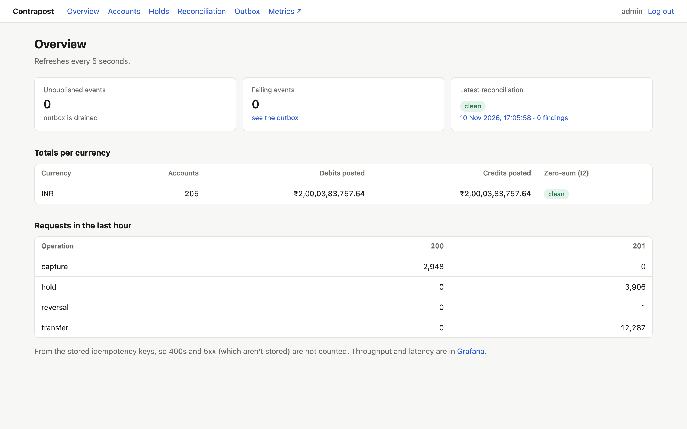
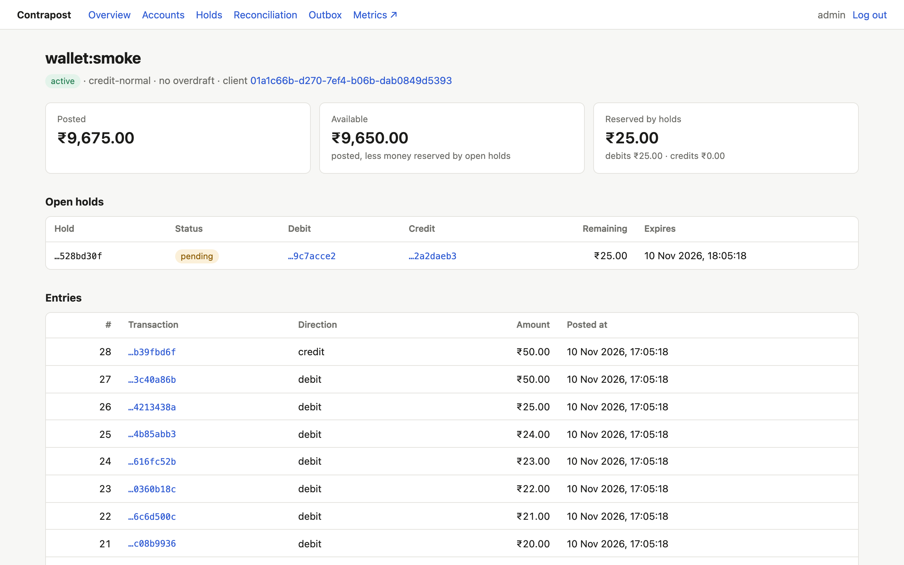
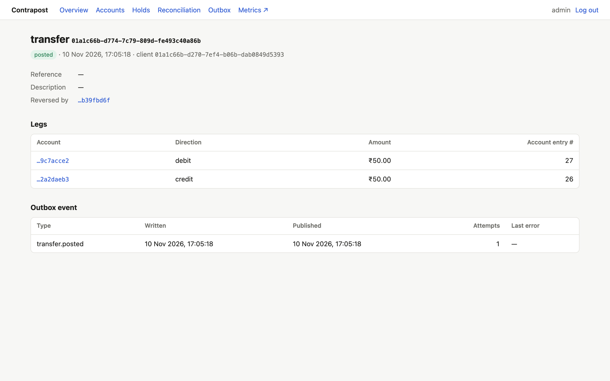
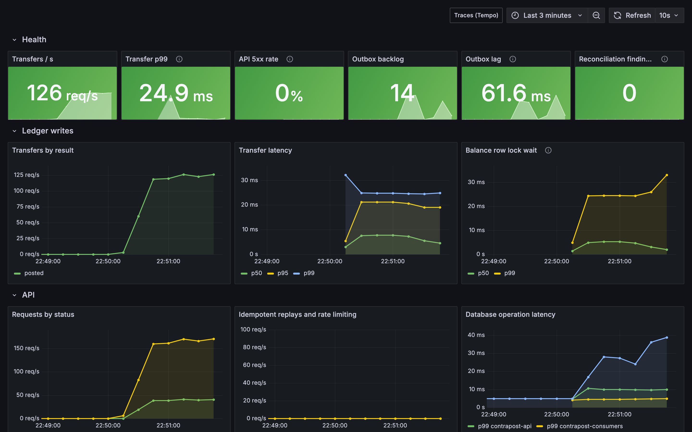
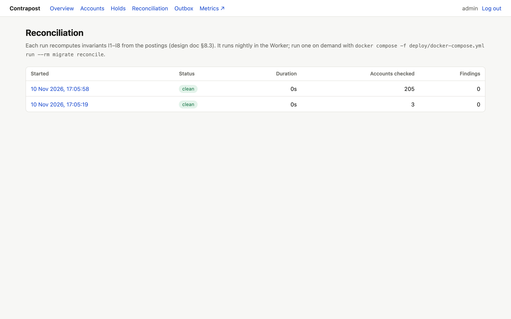
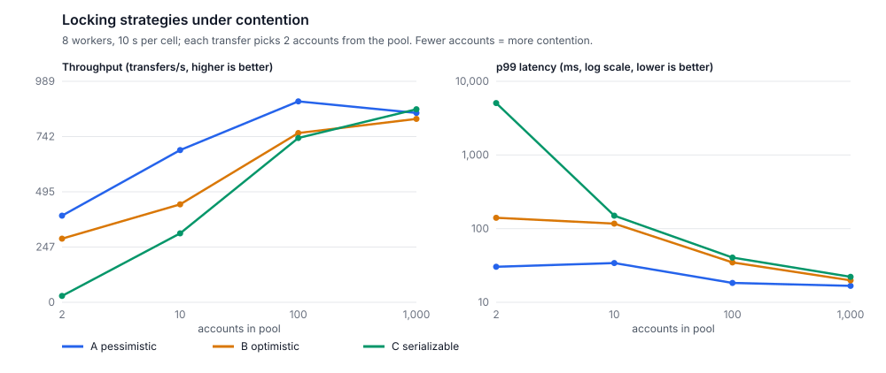

# Contrapost: a payments ledger that stays correct under load, retries and crashes

A double-entry ledger in .NET 10 and PostgreSQL, with RabbitMQ events, a Redis rate limiter, OpenTelemetry, and a read-only operator dashboard in Next.js. It was built to answer one question with evidence rather than claims: **what does it take for balances to stay exactly right when many requests hit the same accounts, clients retry, and processes die mid-flight?**



**In numbers**

| | |
|---|---|
| Concurrency run (64 workers, 5 min, random transfers, holds, captures, voids, reversals and retries) | 256,357 requests, 0 server errors, reconciliation **clean** |
| Retried requests replayed | 38,591, every one with the original status and JSON |
| Locking strategies benchmarked under maximum contention | pessimistic 388/s (p99 30 ms) vs optimistic 285/s with 243 abandoned vs serializable 28/s (p99 5 s) |
| Chaos runs | 5 of 5 passed: API killed, broker down 2 min, relay killed mid-batch, +200 ms database latency, Redis down |
| Laptop load test (`uniform`, 5 users) | 736 requests/s, transfer p99 28 ms |

The code, design doc and every result are in this repository: [README](../README.md), [design doc](../Contrapost-Design-Doc.md), [ADRs](adr/README.md), [results](results/).

---

## 1. The problem

Moving money between two accounts sounds like one `UPDATE`. In production it is several problems at once:

- **Concurrency.** Two requests read the same balance, both see enough money, both spend it. Or two transfers lock the same two accounts in opposite order and deadlock.
- **Retries.** A client times out and retries. Did the first attempt go through? If the server can't tell, the customer is charged twice.
- **Crashes.** The process dies after the database commits but before it replies, or after it publishes an event but before it commits.
- **Drift.** A bug, a bad migration or a manual fix leaves a balance that no longer matches its history, and nobody notices for months.

Contrapost treats each of these as a requirement with a test, a measurement, or both.

## 2. The model

- **Double entry.** Every business event is a transaction of two or more postings, and its debits equal its credits. Money is never created or destroyed, only moved. Across all accounts in a currency, debits equal credits (invariant I2, shown live on the dashboard).
- **Integer minor units.** Amounts are `bigint` paise, never floating point, so every check is exact integer equality ([ADR-002](adr/ADR-002-integer-minor-units.md)).
- **Posted and pending.** Each account keeps four running totals: debits and credits, posted and pending. A hold (a card authorization, say) reserves money by raising the pending totals without moving it; a capture turns part or all of it into real postings. Postings only ever record money that has moved ([ADR-007](adr/ADR-007-holds-record-pending-money.md)).
- **Immutable history.** Postings are never updated or deleted. A mistake is undone by a reversal transaction that mirrors the original, and a transaction can be reversed only once.

The overdraft rule is one line that covers holds too: for a wallet, `debits_posted + debits_pending ≤ credits_posted`. Held money can't be spent twice.



## 3. Making writes safe

A transfer is one database transaction:

```mermaid
sequenceDiagram
    participant C as Client
    participant A as API
    participant DB as PostgreSQL
    C->>A: POST /v1/transfers (Idempotency-Key)
    A->>DB: BEGIN; claim the idempotency key (INSERT … ON CONFLICT DO NOTHING)
    alt key already completed
        A-->>C: the stored response, replayed
    else new key
        A->>DB: lock balance rows in account-id order (FOR UPDATE)
        A->>A: check currency, status, overdraft
        A->>DB: insert transaction + postings, update balances
        A->>DB: insert outbox event, store the response on the key
        A->>DB: COMMIT
        A-->>C: 201 Created
    end
```

Three layers make it safe:

1. **Ordered row locks.** Balance rows are locked in sorted account-id order, so two transfers on the same accounts queue instead of deadlocking, and every value a decision depends on is locked before it's read ([ADR-003](adr/ADR-003-pessimistic-ordered-locking.md)).
2. **Idempotency keys in the same transaction.** The key is claimed, the money moves and the response is stored in one commit. If the server dies before the commit, Postgres rolls everything back and the retry starts fresh. If it dies after, the retry gets the stored response. A duplicate arriving while the first is still running waits on the uncommitted key, then replays.
3. **Database guards.** The schema enforces what must never break even if the code does: deferred triggers check every transaction balances at commit, postings are append-only, a `CHECK` constraint forbids overdrafts, composite foreign keys keep tenants and currencies apart ([ADR-008](adr/ADR-008-database-guards.md)). Each guard has a test.

**A bug the testing found.** The first 5-minute concurrency run failed: 17 of 264,000 requests returned `500`. The idempotency code set `SET LOCAL lock_timeout` to bound the wait on a duplicate key, but `SET LOCAL` lasts for the whole transaction, so ordinary waits for busy balance rows timed out too. Nothing was corrupted (every failed transaction rolled back, and reconciliation stayed clean), but clients got errors. The fix resets the timeout as soon as the key is claimed; ordered locking already makes those waits deadlock-free. A regression test holds a balance row longer than the key timeout and checks the transfer waits and succeeds.

## 4. Getting events out reliably

Every committed transfer must produce exactly one event for downstream consumers. Publishing to the broker from the request is a dual write: commit first and a crash loses the event; publish first and a failed commit sends an event for money that never moved.

Contrapost uses a **transactional outbox** ([ADR-004](adr/ADR-004-transactional-outbox.md)). The event is a row written in the same transaction as the money. A relay in a separate Worker claims rows with `FOR UPDATE SKIP LOCKED`, publishes them to RabbitMQ with publisher confirms ([ADR-005](adr/ADR-005-rabbitmq.md)), and marks them published only once confirmed. Delivery is therefore at-least-once, so each consumer keeps an **inbox**: it commits the inbox row and its own effect together, and acks only after that.



## 5. Trying to break it

**Concurrency harness.** 64 workers ran random transfers, holds, captures, voids and reversals against 1,000 wallets for 5 minutes, deliberately retrying with reused keys and attempting overdrafts. Then reconciliation recomputed every balance from its postings and holds. Result: 256,357 requests, 0 server errors, every replay identical, **0 findings** ([results](results/concurrency-m5.md)).

**Property tests.** FsCheck generates random sequences of operations against the domain rules and checks the invariants after each.

**Chaos runs**, each ending with the same checks (every event delivered once per consumer, statements complete, no balance drift):

| Run | What happened | Result |
|---|---|---|
| C1 | API `SIGKILL`ed 3 times under load; clients retry with the same key | 6,204 transfers, each posted exactly once |
| C2 | RabbitMQ stopped for 2 minutes under load | API kept accepting (21,936 transfers, all `201`); outbox backed up to 18.8k rows, drained in 100 s |
| C3 | Relay killed 8 times mid-batch | 674 duplicate deliveries, all absorbed by the inbox |
| C4 | 200 ms added to every Postgres response | Throughput fell from 122 to 1.7/s; no deadlocks, no drift; recovered at once |
| C5 | Redis stopped under a 300/min limit | Rate limiter failed open as designed: 4,280 requests, 0 errors, alert fired |

Details: [C2 and C3](results/chaos-m4.md), [C1, C4 and C5](results/chaos-m6.md).



**Self-verification.** A reconciliation job re-derives eight invariants from the source of truth: balanced transactions, global zero-sum, posted and pending balances against postings and holds, hold captures, one event per transaction, single reversals. It runs nightly, on demand, and after every benchmark cell; a Prometheus alert fires on any finding.



## 6. What I measured and learned

**Waiting beats retrying under contention.** I implemented three concurrency strategies behind one interface and benchmarked them on a CI runner, from every transfer colliding (2 accounts) to almost none (1,000):



- With every transfer colliding, pessimistic ordered locking did 388 transfers/s at a p99 of 30 ms and never gave up. Optimistic locking abandoned 243 transfers after 10 retries; serializable isolation collapsed to 28/s with a 5-second p99. A retry repeats the whole read-decide-write cycle, and that work grows with contention; a queued lock wait doesn't.
- With little contention, all three were within 5%. **A test with little overlap would have hidden the difference**, which is why the benchmark sweeps contention.
- Medians mislead: the losing strategies had *lower* p50s under contention, because the requests that got through did so without waiting. p99 and the give-up count told the truth.

**Other things worth knowing:**

- **A hot account is the real ceiling.** Even the best strategy serializes transfers on one balance row. The `hot_account` load test cuts throughput by a third at only 5 users. Sharding a hot account into sub-accounts is the next step.
- **Round trips matter more than they look.** C4 showed a transfer makes about 11 sequential trips to Postgres. Invisible on localhost, it is 10–20 ms per transfer against a database in another zone, so the API and database belong in the same region, and batching statements would help.
- **Test the observability too.** Taking the screenshots for this write-up showed the reconciliation-findings gauge stuck at -1: only the Worker's own nightly run set it, so an on-demand run that found drift wouldn't have fired the alert. The gauge now reads the latest run from the database.
- **Writing the ADRs was an audit.** Checking each claim against the code found three designed features that were never built (two cleanup jobs and a least-privilege database role). They're now marked as such rather than claimed.

**What I'd do next:** hot-account sharding, the two cleanup jobs and separate database roles, write actions in the dashboard with an audit trail, and a cloud deployment with a public demo.

---

*Stack: .NET 10 Minimal APIs, PostgreSQL 16 (Dapper on the write path), RabbitMQ, Redis, OpenTelemetry with Prometheus, Grafana and Tempo, Next.js 16, xUnit with Testcontainers and FsCheck, k6, Playwright, Docker Compose, GitHub Actions.*
