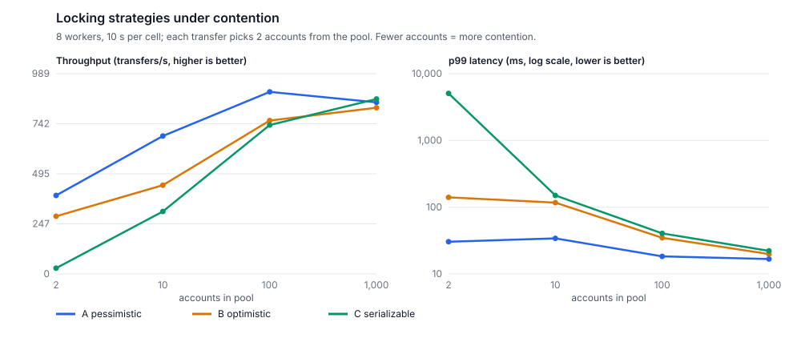

# Locking strategies under contention (milestone M6)

Design doc §8.1 compares three ways to keep concurrent transfers from corrupting balances. All three share the same domain rules and write SQL (`src/Contrapost.Infrastructure/Ledger/LockingStrategies.cs`):

| Strategy | Mechanism |
|---|---|
| **A pessimistic** (production) | `SELECT … FOR UPDATE` on the balance rows in account-id order, then decide and write. Waits; never retries |
| **B optimistic** | Read without locks; `UPDATE … WHERE version = @v` per account, in account-id order; retry when another writer got there first |
| **C serializable** | Plain reads and writes under `SERIALIZABLE`; retry on serialization failure (`40001`) |

Retries back off with jitter and give up after 10 attempts.

**Method:** `bench/Contrapost.Benchmarks`.
- 8 writers post transfers for 10 s per cell. Each transfer picks 2 accounts at random from a pool of 2, 10, 100 or 1,000; the smaller the pool, the more transfers collide.
- Every cell runs against its own freshly migrated database, after an unmeasured 2 s warm-up.
- After every cell, **reconciliation must be clean**: a strategy that is fast but wrong would show up here.

**Hardware:** a GitHub Actions `ubuntu-latest` runner (4 vCPUs, 15 GB RAM) running PostgreSQL 16 in Docker, with nothing else competing for it ([benchmark workflow](../../.github/workflows/benchmark.yml), run 40201770174). Raw data: [`locking-benchmark.csv`](locking-benchmark.csv).



| Strategy | Accounts in pool | Transfers/s | p50 | p99 | Avg attempts | Gave up | Reconciliation |
|---|---:|---:|---:|---:|---:|---:|---|
| A pessimistic | 2 | 388 | 20.3 ms | 30.4 ms | 1.00 | 0 | clean |
| B optimistic | 2 | 285 | 3.6 ms | 140.3 ms | 1.90 | 243 | clean |
| C serializable | 2 | 28 | 3.7 ms | 5,066 ms | 1.88 | 26 | clean |
| A pessimistic | 10 | 681 | 10.1 ms | 34.1 ms | 1.00 | 0 | clean |
| B optimistic | 10 | 438 | 6.4 ms | 116.9 ms | 2.15 | 34 | clean |
| C serializable | 10 | 309 | 7.1 ms | 150.0 ms | 2.18 | 22 | clean |
| A pessimistic | 100 | 899 | 8.3 ms | 18.3 ms | 1.00 | 0 | clean |
| B optimistic | 100 | 758 | 8.8 ms | 34.8 ms | 1.23 | 0 | clean |
| C serializable | 100 | 736 | 8.7 ms | 40.5 ms | 1.25 | 0 | clean |
| A pessimistic | 1,000 | 847 | 9.2 ms | 16.7 ms | 1.00 | 0 | clean |
| B optimistic | 1,000 | 821 | 9.4 ms | 19.9 ms | 1.02 | 0 | clean |
| C serializable | 1,000 | 864 | 8.8 ms | 22.2 ms | 1.04 | 0 | clean |

## What it shows

- **Under contention, waiting beats retrying.** With every transfer colliding (a pool of 2), A does 388 transfers/s with a p99 of 30 ms and never gives up.
  - **B loses work:** 243 transfers were abandoned after 10 attempts, and its p99 is 4.6× A's.
  - **C collapses:** 28/s, with a p99 of 5 s, because most attempts end in a serialization failure.
  - A retry repeats the whole read-decide-write cycle, and that work grows with contention. A queued lock wait doesn't.
- **Without contention the choice barely matters.** At a pool of 1,000, all three are within 5% of each other (821–864/s, p99 17–22 ms). Optimistic and serializable approaches look fine in tests with little overlap, and degrade only once accounts get hot.
- **p50 can mislead.** B's and C's medians are lower than A's under contention, because the requests that get through do so without waiting. The p99 and the give-up count show the cost. This is why the design doc tracks p99 and why the alert is on p99.
- **All three are correct.** Every cell reconciled clean. Under `SERIALIZABLE`, colliding writers sometimes hit the postings `(account_id, account_seq)` unique index before Postgres reports a serialization failure. The M1 database guard caught it, and C treats it as a retryable conflict.
- **The limit is the hot account itself.** Even A tops out at a pool of 2, because transfers on the same two rows run one at a time. That's the case for hot-account sharding (§8.2).

## Decision

Keep **A** in production ([ADR-003](../adr/ADR-003-pessimistic-ordered-locking.md)). It is never slower than the alternatives by more than measurement noise, it is much better under contention, and it never abandons a transfer.

## Reproducing

```bash
# Light local run (4 writers, 5 s per cell). Other load on the machine skews every cell, so prefer a quiet machine or CI.
dotnet run -c Release --project bench/Contrapost.Benchmarks
# The published configuration
dotnet run -c Release --project bench/Contrapost.Benchmarks -- --workers 8 --seconds 10
# On a dedicated runner: Actions → benchmark → Run workflow
```

The first local runs on a laptop were also useful, as a test of the benchmark itself: they ran every cell in one database, and later cells slowed down as it grew. That is why each cell now gets its own database.
